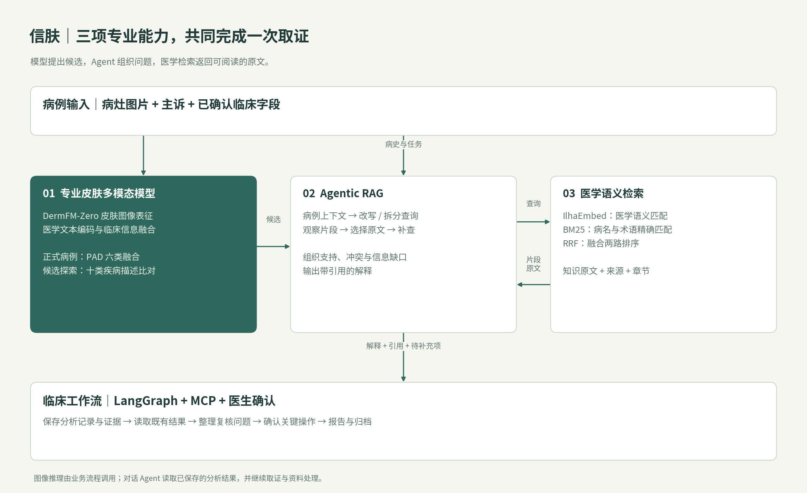
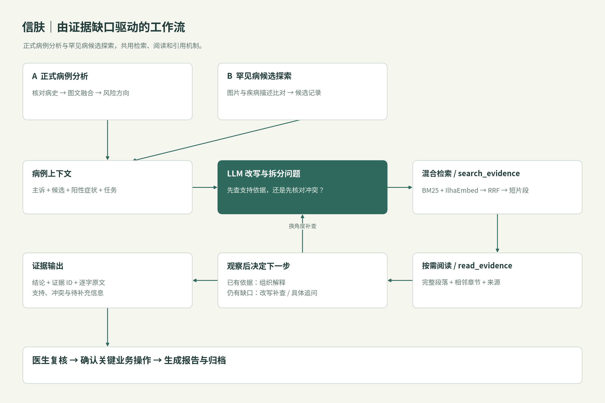
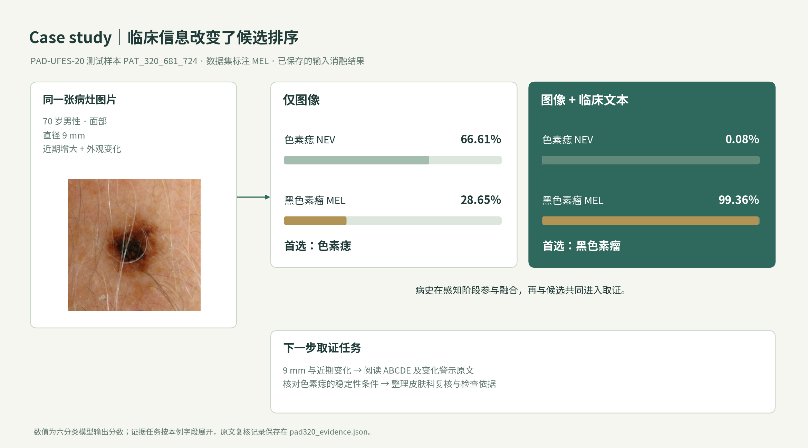
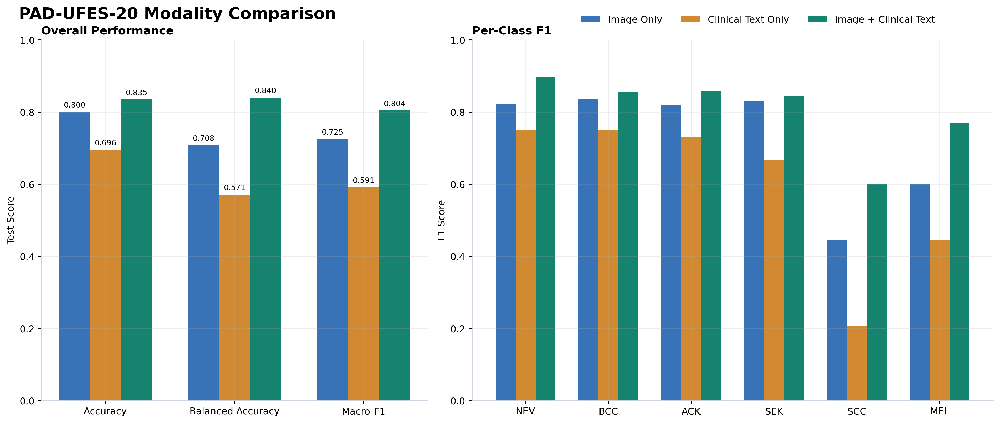

# 信肤 · Xinfu 项目介绍

**面向基层罕见与疑难皮肤病的专业 Agent 工作台：让病灶线索进入医学取证，让取证结果衔接复核、转诊与病例工作。**

信肤围绕基层首诊的一条连续任务设计：医生提交病灶图片与病史，专业皮肤多模态模型提供候选，LLM 将候选与病史转成医学问题，医学嵌入模型帮助查找相关资料，Agent 阅读原文并围绕缺口继续查询，最后把依据、待核对问题和资料整理任务交回医生工作台。

项目的差异化集中在三个连接处：**病史参与感知，候选驱动取证，证据进入业务。**

## 1. Motivation：基层需要接住“低频、相似、信息不全”的病例

### 1.1 长尾在数据形成阶段就已出现

基层首诊面对的是尚未整理好的问题：患者先描述“红、痒、起疹、一直不好”，医生还要判断应观察哪些形态、补问哪些病史，以及何时沿着少见疾病方向查证。罕见病的困难同时存在于病例积累、早期线索识别和专科知识获取三个环节。

PAD-UFES-20 提供了一个与基层设备条件相关的数据观察窗口：它采用临床手机图片，并配有患者临床信息。原始采集涉及 50 余种皮损，最终六分类数据集将许多样本较少的疾病排除在外。**临床问题的范围，比最终训练标签的范围更广。** 这一数据形成过程是本项目设计罕见病候选探索与外部知识取证的直接动机。[PAD-UFES-20 原始研究](https://pmc.ncbi.nlm.nih.gov/articles/PMC7479321/)

本项目使用的 2,298 张 PAD 图像分布如下：

| 类别 | 图像数量 | 占比 |
| --- | ---: | ---: |
| 基底细胞癌 BCC | 845 | 36.77% |
| 日光性角化病 ACK | 730 | 31.77% |
| 色素痣 NEV | 244 | 10.62% |
| 脂溢性角化病 SEK | 235 | 10.23% |
| 鳞状细胞癌 SCC | 192 | 8.36% |
| 黑色素瘤 MEL | 52 | 2.26% |

最多与最少类别相差 **16.25 倍**。这组数据刻画的是项目采用的临床图像基准；由此形成的设计判断是：**高频标签分类、低频候选探索和病例知识取证，需要分别承担职责，并在同一工作流中汇合。** [本地数据统计](./artifacts/training/pad_multimodal/dataset_audit.json)

### 1.2 业务痛点决定了专业 Agent 的任务边界

| 基层首诊中的问题 | 单次模型输出之后仍要完成的工作 | 信肤的设计落点 |
| --- | --- | --- |
| 病灶外观相似，关键病史散落在叙述中 | 核对年龄、部位、病程、尺寸与近期变化 | 结构化病例与图文融合分析 |
| 少见病缺乏足量本地样本 | 提出值得继续核对的疾病方向 | 专业图文表征与疾病描述比对 |
| 患者口语与指南术语不一致 | 把“抬手费劲”等描述组织成专业检索问题 | LLM 查询改写与医学语义检索 |
| 找到相关资料，却不清楚是否适用于本例 | 阅读条件、核对冲突、补充缺失信息 | 按证据缺口推进的 Agentic RAG |
| 候选、依据、报告和病例分别存放 | 整理复核材料并关联到正确记录 | MCP 工具、病例状态流程与医生确认 |

我们的 Motivation 是把这些断点连接起来：**低频病例即使缺少足量专病标注，也能从专业视觉线索出发，逐步组织专业问题、查阅依据并形成可继续处理的首诊材料。**

## 2. 差异化：从通用工具循环走向病例驱动的专业协作

普通工具型 Agent 通常沿着“用户目标 → LLM 选择工具 → 观察结果 → 再次行动”推进任务。这一循环赋予系统灵活性，ReAct 是其中的代表性方法。[ReAct 原始研究](https://arxiv.org/abs/2210.03629)

皮肤首诊还需要解决三个具体问题：感知输入是否贴近皮肤领域，检索是否理解医学表达，以及工具结果如何成为本例的依据。信肤围绕这三个问题组织模块。

| 技术问题 | 通用组合中容易出现的断点 | 信肤的对应设计 | 传给下一环节的数据 |
| --- | --- | --- | --- |
| 通用多模态模型理解“图片内容”，专业任务需要辨别病灶细节 | 自然图像语义与皮肤形态、医学描述存在领域差异 | DermFM-Zero 皮肤领域底座；正式病例结合临床文本分析 | 候选列表、分类分数与病例记录 |
| LLM 能解释医学词汇，检索仍可能匹配不到资料 | 口语、病名别称、缩写与中英混写造成表达错位 | LLM 改写问题；IlhaEmbed 与 BM25 双路召回，RRF 融合 | 带来源与章节的证据片段 |
| 固定检索后直接生成，容易遗漏适用条件 | “相关”被直接当作“支持”，矛盾信息被跳过 | 检索与阅读分开；观察原文后决定补查、追问或结束 | 有引用的解释、冲突与信息缺口 |
| 通用 Agent 连续执行，业务对象和状态容易脱节 | 回答生成后仍需人工搬运资料，写入动作缺少确认 | LangGraph 承接病例流程，MCP 暴露业务能力，关键操作进入确认卡 | 关联病例的报告、文档与任务记录 |

**项目创新落在模块之间的信息组织与执行机制：专业模型的候选会改变检索问题，读取到的原文会改变后续行动，形成的依据又能继续进入病例业务。**

## 3. 协同架构：三个模块各自解决什么问题



图中的主线是“病例 → 候选 → 问题 → 原文 → 工作材料”。病史同时进入专业分析与查询组织，保留了患者事实；视觉候选为查询提供方向；医学检索返回资料；Agent 根据读到的内容调整任务。

### 3.1 专业皮肤多模态模型：把图片与临床信息变成候选线索

信肤选用 **DermFM-Zero** 作为专业感知底座。上游模型以约 300 万皮肤图像学习细粒度表征，再以约 100 万图文对与 PubMedBERT 医学文本编码器进行对齐。专业形态与医学描述因此进入同一建模过程。[DermFM-Zero 训练方法](https://arxiv.org/html/2602.10624v1)

项目在此基础上组织两条入口：

| 入口 | 输入与处理 | 承担的任务 |
| --- | --- | --- |
| 正式病例分析 | 病灶图片 + 医生确认的结构化临床信息；冻结图像与文本编码器，训练融合模块和分类头 | PAD 六分类中的图文联合分析，输出候选与风险流程所需数据 |
| 罕见病候选探索 | 图片特征与预设疾病英文描述进行图文相似度比对；病例叙述随后参与取证 | 在十类疾病候选中组织零样本线索探索，并保存候选记录 |

候选探索覆盖皮肌炎、毛发红糠疹、寻常型天疱疮、大疱性类天疱疮、硬化性苔藓等十类疾病。其作用是让系统能沿着疾病文本提出取证方向；正式病例融合则把年龄、部位、尺寸和近期变化直接用于联合分析。

本项目完成底座接入、融合训练、候选结果保存与取证衔接。**专业感知的输出保持为结构化线索，后续 Agent 可以读取真实分析记录，继续核对支持条件与冲突。**

### 3.2 医学嵌入模型：把病例表达与资料表达接起来

LLM 的语言生成能力与检索模型的排序能力承担不同任务。医生说“举手梳头费劲”，资料可能写“近端肌无力”；病例中出现的中文病名，也可能对应英文标题、缩写和医学术语。查询需要先被组织，资料还需要被正确召回。

信肤将这两个环节分工：

- **LLM 组织问题。** 读取主诉、视觉候选和阳性症状，将复合问题拆为鉴别、检查、风险与转诊等检索角度。
- **IlhaEmbed 匹配医学语义。** 为查询和知识片段编码，补充临床术语、缩写与中英混写的语义匹配。该模型面向临床语言语境设计。[IlhaEmbed 模型说明](https://huggingface.co/weemed/IlhaEmbed)
- **BM25 保留精确线索。** 病名、检查名与特异术语仍参与关键词匹配；RRF 融合两路排名，并按来源页面去重。

这里有两类容易混淆的医学文本能力：

| 文本能力 | 所在模块 | 参与的比较 |
| --- | --- | --- |
| DermFM 的医学文本编码器 | 专业多模态感知 | 临床描述与病灶图像的联合分析，或疾病描述与图片的匹配 |
| IlhaEmbed 医学嵌入 | 知识检索 | 查询与知识片段的语义相关性排序 |

**前者帮助形成候选，后者帮助找到候选所需的依据。LLM 再把两者组织成可推进的任务。**

### 3.3 Agentic RAG：让检索围绕本例尚未解决的问题推进

系统把检索和阅读保留为两个清晰工具：`search_evidence` 返回短片段，`read_evidence` 阅读已找到片段的完整段落及相邻上下文。LLM 自主决定查询、阅读和补查顺序。

例如，候选中出现“色素痣”，病史同时记录“近期增大、外观变化”，下一步就需要核对“稳定痣的观察条件”和“变化性病灶的复核依据”。**候选用于提出问题，病史用于限定条件，原文用于组织解释。**

读取结果后，Agent 可以选择四种动作：

| 当前观察 | 下一步动作 |
| --- | --- |
| 短片段命中主题，需要核对适用条件 | 阅读完整段落和相邻章节 |
| 找到了支持线索，但鉴别方向仍有冲突 | 换角度改写查询，核对另一候选 |
| 资料涉及本例尚未记录的关键条件 | 列出具体字段，向医生提出补充问题 |
| 已有资料能回答本次问题 | 汇总有引用的解释并结束本轮 |

最终输出组织为结论、证据 ID、逐字支持原文和信息缺口。程序核对证据 ID 与引文归属，LLM 判断语义支持、条件和冲突，工作台展示原文供医生复核。

## 4. 工作流：在需要的地方自主，在业务交接处保持明确状态



**正式病例路径**从图片与叙述开始，经结构化提取和医生核对后建档，调用本地专业模型与风险流程，再把主诉、Top 候选、阳性症状和风险理由交给取证模块。**罕见病探索路径**先保存图文比对候选，医生选定该记录后，可以继续深度取证与资料整理。

两条路径共用医学证据工具。自动病例分析由取证 Agent 调用工具；对话 Agent 直接使用同一组检索、阅读工具继续工作，避免在对话内部再嵌套一层 Agent。

MCP 统一连接取证、病例读取、报告与文档等能力。LangGraph 承接病例和报告状态，创建或修改正式业务记录等关键 Agent 动作通过确认卡交给医生。每个交接点都有明确对象：哪次分析、哪份证据、哪份病例、准备执行什么操作。

## 5. Case study 一：同一张图片，临床信息如何改变后续取证方向

### 5.1 真实测试样本与候选变化

样本 **PAT_320_681_724** 来自 PAD-UFES-20 测试集。元数据记录：70 岁男性，面部病灶，直径 9 mm，近期增大且外观变化；数据集标注为黑色素瘤 MEL。三种输入模式的预测已保存在项目实验记录中。



| 输入模式 | 首选候选 | 色素痣 NEV 分数 | 黑色素瘤 MEL 分数 |
| --- | --- | ---: | ---: |
| 仅图像 | 色素痣 | 66.61% | 28.65% |
| 图像 + 临床文本 | 黑色素瘤 | 0.08% | 99.36% |

表中数值为六分类模型输出分数。**在这个样本中，年龄、部位、尺寸和变化信息进入融合后，候选排序发生了改变。** 对基层工作流而言，关键价值在于这些临床字段参与了感知，并继续保留在后续检索问题中。

### 5.2 从候选转为具体取证问题

按本例字段，可以把“这个病灶是什么”展开为两个可查证问题：

```text
70岁 男性 面部 9毫米 近期增大 外观变化
黑色素瘤 色素痣 ABCDE

melanoma evolving pigmented lesion urgent assessment biopsy
```

本例文档复核使用这些查询执行了本地 BM25 检索，并通过阅读工具继续打开相邻段落；模型预测和这次原文复核分别记录在[案例数据文件](./artifacts/case_studies/pad320_evidence.json)中。

| 真实证据 ID | 该段落提供的信息 | 与本例相连的问题 |
| --- | --- | --- |
| `GUIDE_AAD_MELANOMA#C01` | ABCDE 中的直径与持续变化警示 | 9 mm 与近期外观变化对应哪些复核线索？ |
| `GUIDE_AAD_MELANOMA#C02` | 异常色素斑与增大、变色、变形等变化的评估方向 | 如何把病例中的变化信息带入皮肤科复核？ |
| `GUIDE_AAD_MELANOMA#C03` | 医生检查、皮肤镜与组织病理的作用 | 后续应围绕哪些检查依据整理材料？ |

检索首先命中 ABCDE 段落；阅读相邻内容后，进一步看到变化警示和检查说明。AAD 原文也将直径与演变列为应关注的病灶特征。[AAD：黑色素瘤 ABCDE](https://www.aad.org/public/diseases/skin-cancer/abcdes-melanoma)

### 5.3 这个案例说明了什么

专业模型让临床信息改变候选排序；取证任务随后同时保留“黑色素瘤方向”和“色素痣的稳定性条件”，核对两者与病程的关系。医生收到的材料因此包含本例字段、模型候选、具体原文和后续复核问题。**图文融合解决线索形成，检索与阅读解决依据组织，两者在同一病例上连续工作。**

## 6. Case study 二：皮肌炎罕见病取证任务走读

### 6.1 场景设定：从“皮疹”进入跨越皮肤与肌肉的线索

以这样一组首诊输入展开任务：**眼睑反复紫红、手指关节上方出现皮疹，患者说“最近上楼、抬手梳头比较费劲”，已有皮损图片。**

这一场景选取皮肌炎作为取证主题。皮肌炎的典型皮肤线索包括眼睑紫红改变和 Gottron 丘疹，肌肉受累可以表现为上楼、抬臂等动作困难；其资料需要把皮肤表现与肌肉症状放在一起阅读。[DermNet：成人皮肌炎](https://dermnetnz.org/topics/adult-onset-dermatomyositis)

下面按系统已配置的“皮肌炎 / dermatomyositis”候选及现有取证工具展开，展示本例如何组织查询与复核材料。

### 6.2 三个模块分别承担什么

| 环节 | 本例携带的数据 | 模块完成的工作 |
| --- | --- | --- |
| 专业感知 | 病灶图片；系统配置的皮肌炎疾病描述 | 图文比对提供疾病候选线索，保存分析记录 |
| 病例上下文 | 眼睑改变、指关节皮疹、上楼与抬臂困难 | 将皮肤和全身症状同时带入取证，避免只围绕“皮炎”检索 |
| LLM 查询组织 | 候选 + 原始叙述 + 鉴别与检查任务 | 组织“皮肤特征—肌无力—检查依据”三个角度的问题 |
| 医学语义检索 | 中文描述、英文病名、Gottron、CK 等术语 | IlhaEmbed 匹配医学语义，BM25 保留特异术语，融合返回片段 |
| Agent 阅读与补查 | 来源段落、适用条件、尚未记录的症状 | 阅读肌肉受累与检查章节，列出需要补问的字段 |
| 工作流交接 | 已知事实、候选、资料来源与待补充项 | 整理供医生复核的摘要，继续关联病例与报告任务 |

### 6.3 查询需要如何变化

一次只查“眼睑皮疹”，难以覆盖这个任务。围绕该场景，可以组织如下查询：

| 查询角度 | 查询示例 | 需要从原文核对的内容 |
| --- | --- | --- |
| 皮肤线索 | `dermatomyositis heliotrope rash Gottron papules 眼睑 指关节` | 皮疹部位与形态是否对应候选的典型描述 |
| 病史关联 | `皮肌炎 近端肌无力 上楼困难 抬臂 combing hair` | 口语化动作困难如何对应需要查体确认的肌肉症状 |
| 检查与鉴别 | `dermatomyositis CK myositis antibodies skin biopsy lupus differential` | 检查各自回答什么问题，哪些表现需要与其他结缔组织病比较 |

这里的协同关系是：**专业模型提出皮肌炎方向，LLM 将口语与候选组织成可检索问题，医学嵌入与关键词检索共同找到资料，Agent 阅读后再决定补查什么。**

例如，DermNet 的诊断章节同时讨论肌酶、抗体、肌肉检查，并指出皮肤组织学与皮肤型红斑狼疮可有相似之处。读到这些内容后，任务应继续转向“有哪些肌肉症状需要医生核对”“已有哪些检查结果”“鉴别材料还缺什么”，而非在疾病名上停止。[DermNet：诊断与鉴别章节](https://dermnetnz.org/topics/adult-onset-dermatomyositis#how-is-adult-onset-dermatomyositis-diagnosed)

### 6.4 交给基层医生的材料应长什么样

| 材料部分 | 按本例应组织的内容 |
| --- | --- |
| 已记录事实 | 图片、眼睑与指关节皮疹、患者自述的动作困难及病程 |
| 候选与支持线索 | 皮肌炎取证方向；逐条对应已阅读资料中的皮肤与肌肉描述 |
| 待补充问题 | 动作困难何时出现、分布如何；是否存在吞咽或呼吸相关症状；已有查体及检查结果 |
| 复核与转诊资料 | 需要专科核对的疑点、所依据的原文、已有结果和待补充项目 |

**基层罕见病支持的落点，是把零散表现组织成有方向、有依据的复核材料。** 专业感知提高候选的领域相关性，医学检索跨过表达差异，Agent 把知识转成与当前患者有关的问题，工作流承接后续资料与业务。

## 7. 幻觉与执行问题，分别在哪一层处理

医学幻觉可能发生在多个位置：把未记录的症状当作事实、把视觉候选说成结论、把相似片段说成依据，或引用不存在的原文。信肤在信息交接处分别处理。

| 容易出错的位置 | 对应机制 | 工作台中的结果 |
| --- | --- | --- |
| 患者事实被补写 | 结构化提取、医生核对，正式分析读取关联病例 | 可以定位到已确认的病例字段 |
| 模型结果被转述变形 | 专业模型结果保存，对话工具读取既有分析 | 候选与分数对应具体分析记录 |
| 相关片段被过度推断 | 搜索后按需阅读原文，核对条件、冲突和信息缺口 | 解释与支持原文一起呈现 |
| 证据 ID 或引用内容虚构 | ID 与逐字引文归属校验 | 引用能够回到真实知识片段 |
| 工具执行作用于错误业务对象 | 病例状态、对象关联、操作预览与医生确认 | 关键写入有明确目标与确认步骤 |

自主性主要放在查询改写、资料阅读、缺口判断和工作文档整理中。图像分析由专业服务执行，临床业务动作由状态流程承接。**任务可以灵活推进，每一步使用的事实、来源和业务对象仍可追溯。**

## 8. 让机制保持简洁，并控制任务开销

系统采用一个清晰的取证循环：**提出查询 → 搜索片段 → 按需阅读 → 观察后决定补查或结束。** 简单问题可以一次检索结束，疑难问题根据实际缺口继续；无需为每种疾病增加一套专用查询流程。

- 同次搜索可提交多个查询角度，减少串行往返。
- 先返回短片段，再按需阅读上下文，控制模型输入量。
- 对查询和阅读结果使用本轮缓存，避免重复获取。
- 自动取证使用工具次数、模型轮次和总时长预算控制开销。
- 对话 Agent 直接复用检索、阅读工具，避免 Agent 层层嵌套。

标准模式保留写作、编程、办公与自主联网能力；需要外部事实时使用通用搜索和网页阅读。深度模式在医学解释中加强原文依据与条件核对。普通任务与专业取证在同一个工作台按目标调用能力。

## 9. 实验验证：临床信息为什么需要进入感知

PAD-UFES-20 三种输入模式采用相同的作者划分：训练 1,838、验证 230、测试 230 张图片，按验证集 Macro-F1 选择权重。以下结果用于比较输入方式。[划分记录](./artifacts/training/pad_multimodal/dataset_audit.json)

| 输入模式 | Accuracy | Balanced Accuracy | Macro-F1 |
| --- | ---: | ---: | ---: |
| 仅图像 | 80.00% | 70.80% | 72.53% |
| 仅临床文本 | 69.57% | 57.14% | 59.11% |
| 图像 + 临床文本 | **83.48%** | **84.02%** | **80.40%** |

在这一六分类输入消融中，融合模式相对仅图像的 Balanced Accuracy 提升 **13.22 个百分点**，Macro-F1 提升 **7.88 个百分点**。类别分布不均时，融合带来的收益在均衡指标上更明显；这与项目将病史用于专业感知的设计方向一致。[实验指标](./artifacts/training/pad_multimodal/comparison.json)



工作台支持训练曲线、混淆矩阵与逐样本预测复核。Case study 一展示其中一个可追溯测试样本；Case study 二展示同一协作机制如何组织罕见病取证任务。

## 10. 开发框架与模块对应

| 模块 | 技术与开发工具 | 主要职责 |
| --- | --- | --- |
| 医生工作台 | React、Vite、Markdown 渲染 | 对话、图片、证据阅读、病例和报告编辑 |
| 业务接口 | Python、FastAPI、Pydantic | 结构化输入输出、业务服务与接口 |
| Agent 与流程 | Deep Agents、LangGraph | 自主工具循环、上下文、病例状态与确认 |
| 工具连接 | MCP | 统一暴露取证、病例、报告、文档与公开网络能力 |
| 专业感知 | PyTorch、DermFM-Zero、图文融合模块 | 病灶表征、临床信息融合和候选探索 |
| 医学检索 | IlhaEmbed、BM25、RRF | 医学语义匹配、关键词召回与融合排序 |
| 数据管理 | SQLAlchemy、SQLite | 病例、分析、报告、文档和任务记录 |
| 开发验证 | Conda、Git、pytest、Node.js 测试、Vite 构建 | 环境、版本与回归验证 |

架构对应的核心实现包括[正式病例分析](./backend/app/services/analysis_service.py)、[罕见病候选入口](./backend/app/services/rare_disease_service.py)、[专业模型适配](./pad_multimodal/core.py)、[医学取证服务](./backend/app/services/knowledge_service.py)、[Agentic RAG](./backend/app/services/rag/agent.py)、[混合检索](./backend/app/services/rag/retriever.py)及[对话 Agent 工具编排](./backend/app/harness/open_source_agent.py)。部署与操作见[《操作手册》](./README.md)。

架构图、工作流图和案例图同时提供可编辑的 [SVG 架构图](./artifacts/figures/xinfu_collaborative_architecture.svg)、[SVG 工作流图](./artifacts/figures/xinfu_evidence_workflow.svg)及 [SVG 案例图](./artifacts/figures/xinfu_case_pad320.svg)，可用于项目汇报与排版。
